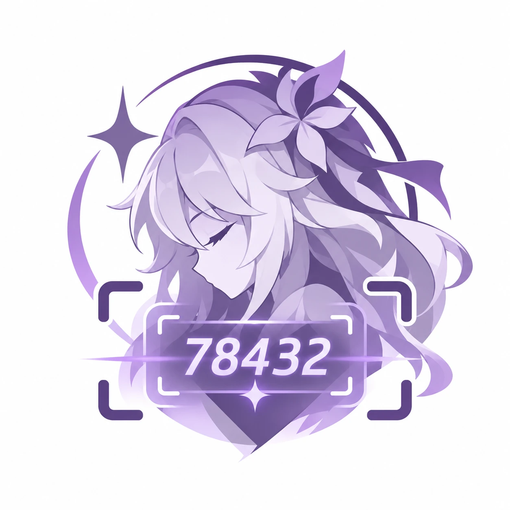
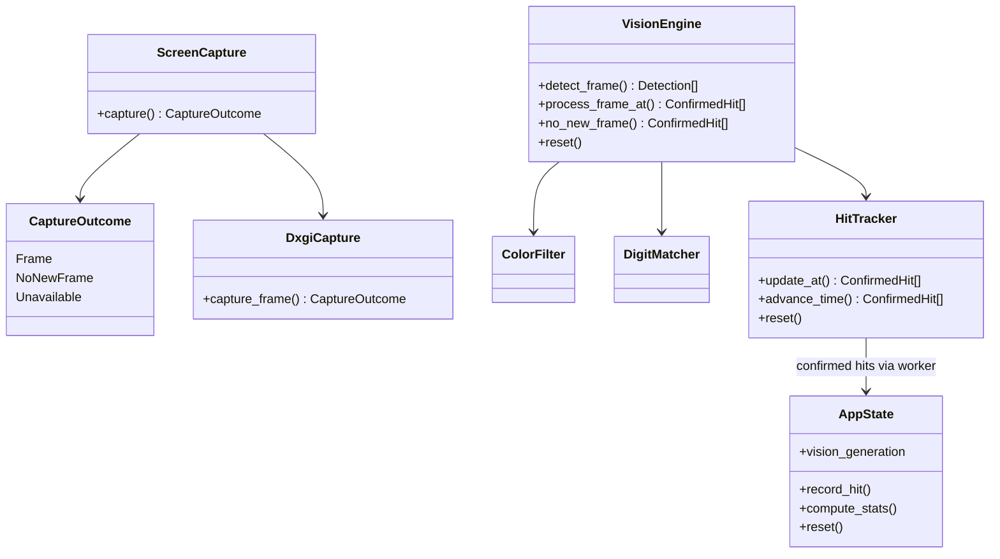

# GenshinDamageLens

<p align="center">
  
</p>

A Windows damage-capture overlay built with Rust, Tauri, DXGI and vanilla JavaScript. It reads visible damage numbers from screenshots and aggregates confirmed hits into rolling DPS, totals, peak hits and elemental breakdowns.

## Running

Requires Windows 10/11, the Rust MSVC toolchain, Node.js and pnpm.

```powershell
pnpm install
pnpm run dev
# Build the desktop application:
pnpm run build
```

The overlay is one small panel on the left edge of the screen; the rest of its window is transparent. It starts in interactive mode: drag it by its title bar (the position is remembered), pause or resume capture, reset the session, or switch to the compact view. Press **F8**, or the lock button, to let clicks pass through to the game; press **F8** again to use the panel. The status line shows **Tracking**, **Waiting for game** or **Paused**. The `···` menu adds simulated hits for trying the panel without the game; reset before measuring real combat.

The panel shows DPS over the last five seconds with a 30-second trend, total damage, average DPS over time spent fighting (gaps of more than five seconds between hits are not counted), hit count, crit rate, peak hit, peak DPS, damage share by element and the most recent hits. The footer shows the capture size, the time per frame spent reading numbers and copying the screen, and the hits confirmed in the last two seconds; the status line shows the frame rate. The terminal prints the same counters as `[Capture diagnostics]`.

The overlay is hidden from screen capture by default, so recorders such as OBS or Streamlabs do not see it. Turn on **Show in recordings** in the `···` menu to make it capturable (use a display or screen capture source; a game capture source only sees the game). While it is on, the capture loop blanks the panel's box in each frame before reading damage, so the panel never reads its own numbers; damage numbers behind the panel are not counted.

A hit appears about 0.6 s after its number shows in game. That is deliberate: the number is watched across frames before its digits are voted on.

Development builds optimize the application's Rust code as well as dependencies. After changing build settings, stop and restart `pnpm run dev` to rebuild it.

## Capture and recognition

1. Find the visible Genshin client area and select its display and graphics adapter.
2. Acquire a DXGI desktop frame and copy it into one of two CPU-readable staging textures; read back the other, copied one frame earlier, and crop it to the game. Frames arrive one frame late, and the read-back never waits for a GPU that the game keeps busy.
3. Label every pixel by damage color through a lookup table, across cores, and collect the row runs. Connected components are built from runs, so large same-colored areas (sand, sky, effects) cost little and are dropped whole.
4. Choose touching-glyph cuts using template scores and assemble number candidates.
5. Recognize digits using normalized template overlap (bit-packed, popcount) and shape checks. Side spurs from same-colored scenery are trimmed first. Recover fragmented digits and check Physical text outlines against both dark and bright backgrounds.
6. Associate readings into tracks by position, size and element. Numbers follow the camera in any direction and shrink after popping in, so any movement or resize marks a track as damage; text that stays put is HUD.
7. After 0.6 s, or when the number disappears after at least 60 ms on screen, vote on the digits per position among readings of the dominant length. A longer reading wins if it repeats exactly and contains the majority reading. Shorter readings inside a tracked number are treated as fragments of it, not as hits. Two-digit values need dense evidence.
8. Record a confirmed track once. A number that is hidden and comes back with the same value is not counted again; equal numbers visible at the same time are all counted.

An ordinary DXGI timeout ages tracks without clearing them. Missing/minimized game capture or a device error clears tracking; device failures trigger reconstruction with a one-second retry interval. Reset and pause invalidate in-flight recognition results.

This is heuristic OCR. It can miss or misread occluded, brief, overlapping or unusually rendered numbers; confidence scores are not calibrated probabilities. Critical-hit classification is a visual size/marker heuristic. Capture uses OS desktop pixels, without game memory reads or injected hooks. No guarantee of recognition accuracy, game policy compatibility, fixed FPS, CPU or memory usage is implied.

## Architecture



| Location | Responsibility |
|---|---|
| `src-tauri/src/lib.rs` | Tauri commands, capture loop, reset/pause generation checks, event delivery |
| `src-tauri/src/capture/` | Window discovery, display selection, desktop capture and crop coordinates |
| `src-tauri/src/vision/filter.rs` | Color labeling, run-based connected components, outlines, glyph splitting and clustering |
| `src-tauri/src/vision/matcher.rs` | Digit templates, fragment recovery, whole-number validation |
| `src-tauri/src/vision/tracker.rs` | Track association, per-digit voting, fragments, expiry and repeat suppression |
| `src-tauri/src/vision/replay.rs` | Labeled recognition/event scoring |
| `src-tauri/src/state.rs` | Session hits, rolling/average/peak DPS and aggregation |
| `src/main.js` | Overlay rendering, IPC and controls |
| `src-tauri/examples/` | Screenshot inspection, labeled replay, live capture probe and recording benchmark |
| `src-tauri/tests/fixtures/` | Checked-in screenshot regressions and labels |

## Validation

```powershell
cargo test --manifest-path src-tauri/Cargo.toml --offline
cargo check --manifest-path src-tauri/Cargo.toml --offline --all-targets
node --check src/main.js
cargo run --manifest-path src-tauri/Cargo.toml --offline --release --example replay -- src-tauri/tests/fixtures/recognition.json --check
cargo run --manifest-path src-tauri/Cargo.toml --offline --release --example replay -- src-tauri/tests/fixtures/electro-events.json --check
```

Remove `--offline` when dependencies have not been downloaded. Test builds optimize the pixel-processing loops. The checked-in recognition tests fail if their images are missing. The older diagnostic and element-video tests in `src-tauri/src/vision/mod.rs` depend on local, gitignored `sample_video/` and `scratch/` recordings and are marked `#[ignore]`, so the default run does not include them. Run them explicitly with `cargo test ... -- --ignored` when those recordings exist; their results are not a complete accuracy benchmark.

See [replay evaluation](docs/recognition.md) for annotation format, metrics and the next OCR decision.

## CI and releases

GitHub Actions runs on Windows runners, since capture is Windows-only.

- **CI** (`.github/workflows/ci.yml`): every pull request to `main` or `dev` and every push to either branch runs the tests, `cargo check --all-targets`, both replay checks and the frontend syntax check. A push to `main` also builds the application and keeps the executable as a workflow artifact for 14 days.
- **Release** (`.github/workflows/release.yml`): pushing a tag such as `v0.2.0` builds the MSI and NSIS installers and publishes a GitHub release with generated notes. The tag is the version: it is written into `tauri.conf.json` and `package.json` during the build, so the installers and the release carry the same number without a version-bump commit.

```powershell
git tag v0.2.0
git push origin v0.2.0
```

Tags must be `v` followed by three numbers; the MSI format accepts nothing else. The installers are not code-signed, so Windows SmartScreen warns on first run.

## Current limits

- F8 is registered as a system-wide hotkey. If another program already owns F8 the overlay falls back to watching the key, which cannot see key presses while a window running as administrator has focus. Genshin Impact normally runs as administrator, so in that case start the overlay as administrator too.
- DXGI captures the visible desktop: other windows can obscure game pixels.
- Selects the monitor containing the game center; a window spanning displays captures only that monitor's intersection. Negative display coordinates are supported; rotated displays are explicitly unsupported.
- A minimum 640 × 480 visible crop is required. HUD exclusion regions and size/color thresholds assume the usual game layout.
- Short capture gaps preserve tracks for up to 450 ms. Hits read fewer than three times are intentionally left unconfirmed.
- The process runs one priority step above normal so that it is scheduled promptly next to the game and a recorder. On a fully loaded CPU each frame still takes two to three times longer than on an idle one.
- Small numbers stacked on top of each other (a burst of several low hits in one spot) are still mostly missed.
- Single digits are still misread at times, mostly on small or overlapping numbers, and an overlapped number can lose its last digit. The hit is counted; its value is off.
- Neural OCR and Windows Graphics Capture are evaluation candidates, not active backends. Keep a recognizer replacement behind the same labeled replay contract and require measured improvements on held-out recordings before switching.
